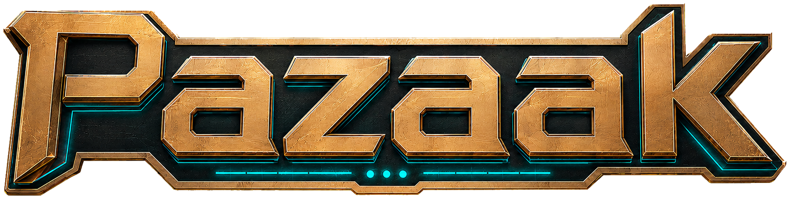
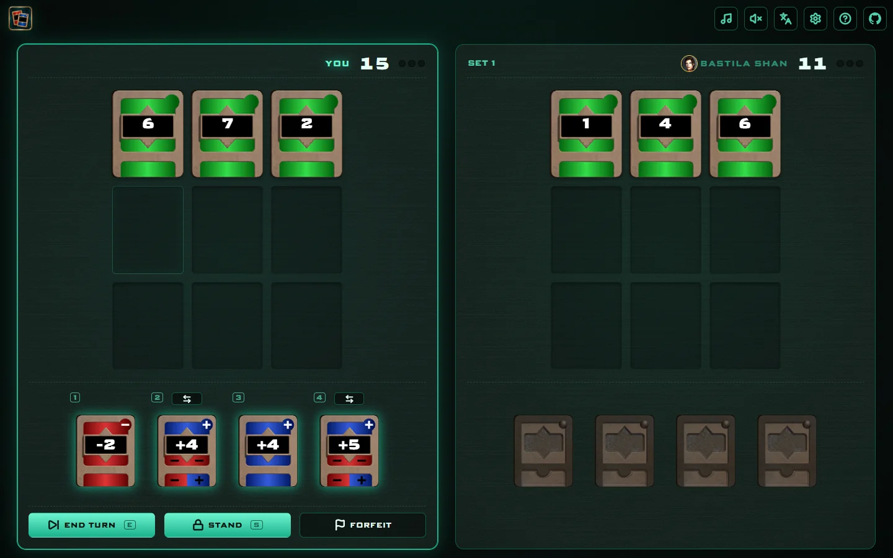
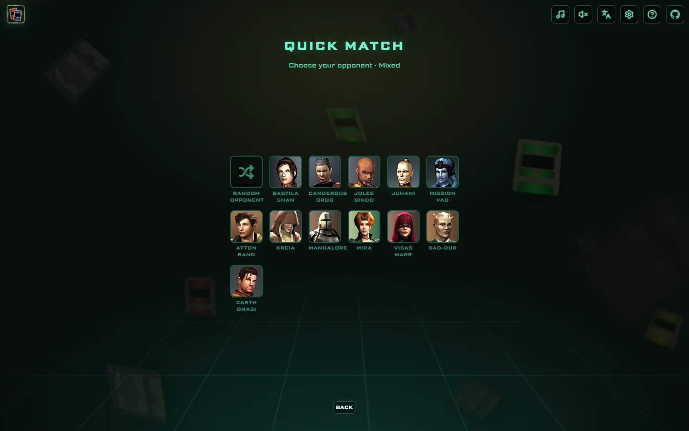
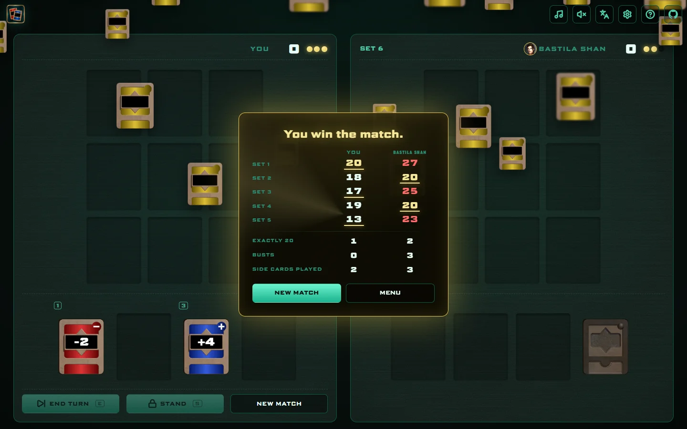
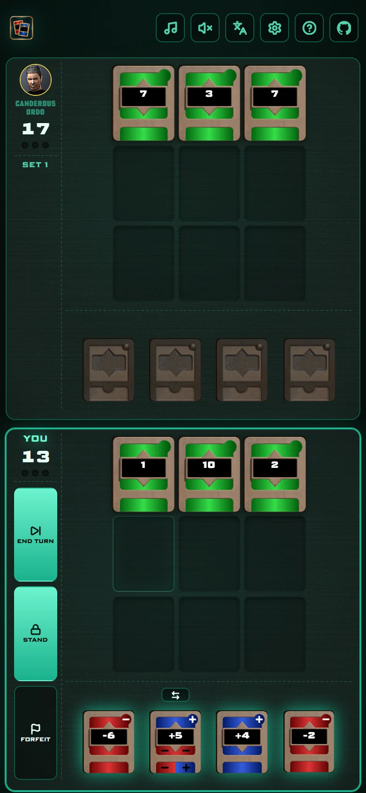
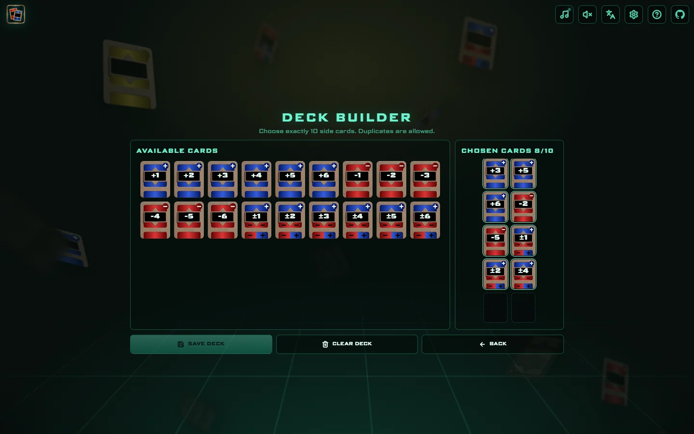

<p align="center">
  
</p>

<p align="center">
  <b>The card game from <i>Knights of the Old Republic</i>, rebuilt for the browser.</b><br />
  Sit down at a cantina table against Bastila, Canderous and the rest of the crew, or deal a friend in over peer-to-peer.
</p>

<p align="center">
  <a href="https://pazaak.app"></a>
  
  <a href="LICENSE"></a>
</p>

<p align="center">
  
</p>

No backend, no account, no install required: everything runs in your browser, and online matches go straight from one player to the other.

## Pick your opponent

<p align="center">
  
</p>

Twelve companions from *KotOR* and *KotOR II*, from Carth and Mission to Kreia and Mandalore, each with a portrait and their own voice lines when the match starts, after each set and when it's over. Their avatar lights up while they talk.

## Modes

- **Quick Match:** one match against a companion of your choice (or a random one), with a classic, flip, mixed or self-built side deck.
- **Campaign:** climb a ladder of five opponents whose side decks get nastier at every step. Four difficulties set the cards you get to work with; in Hardcore a single loss wipes your progress.
- **Deck Builder:** put together your own 10-card side deck, duplicates allowed, and take it into Quick Match or online play.
- **Online:** open a table and share the link or QR code, or join an open table from the lobby. Matches run peer-to-peer over WebRTC ([Trystero](https://github.com/dmotz/trystero)) and survive dropped connections: the guest resyncs to the host's game.
- **Hot Seat:** two players, one device, passing it back and forth.

## At the table

<table>
  <tr>
    <td width="66%"></td>
    <td></td>
  </tr>
</table>

- Side cards fly from your hand to the table; the opponent's leave the exact slot in their hand and turn over on the way. ± cards flip over when you switch their sign.
- Totals roll like an odometer, and hitting 20 or busting gets its own moment on the table.
- Each match ends on a scoreboard with every set and a few stats: exact 20s, busts, side cards played. Wins rain gold cards; losses drain the board of colour while your cards crumble away.
- KotOR interface and card sounds, plus a cantina jukebox with tracks from both games.
- Plays on phones and desktops, portrait or landscape. On Android, busts, 20s and match results buzz the phone.
- Keyboard play on desktop, in English or Polish, and it respects reduced-motion settings.

<p align="center">
  
</p>

## How to play

Pazaak is blackjack with a twist: get closer to **20** than your opponent without going over.

1. **Each turn** you draw a card from the main deck (values 1–10) onto your table.
2. **Side cards:** you bring a 10-card side deck, and 4 of its cards are dealt to you for the whole match. You may play one per turn, each only once. `+` cards add, `−` cards subtract, and `±` cards let you choose.
3. **End turn** to keep drawing next turn, or **Stand** to lock your total.
4. **A set ends** when both players stand, someone goes over 20 (a bust loses the set), or someone fills all 9 slots without busting (that wins it outright). Equal totals are a tie and the set is replayed.
5. **First to win 3 sets** takes the match.

### Keyboard

| Key | Action |
| --- | --- |
| <kbd>E</kbd> | End turn |
| <kbd>S</kbd> | Stand |
| <kbd>1</kbd>–<kbd>4</kbd> | Play the side card in that slot |
| <kbd>Shift</kbd> + <kbd>1</kbd>–<kbd>4</kbd> | Flip the sign of a ± card |

## Under the hood

Built with **React 19**, **TypeScript** and **Vite**, plus **Trystero** for networking and **vite-plugin-pwa** for offline install. No server code.

| Folder | What lives there |
| --- | --- |
| `src/engine/` | The rules: a faithful, UI-free TypeScript implementation of Pazaak, its card pools, campaign decks and the bot. |
| `src/net/` | Online play over Trystero (WebRTC, BitTorrent trackers for signaling). The host runs the engine and streams events and snapshots to the guest. |
| `src/ui/` | The board: card flights, table moments, match summary, sounds and haptics. |
| `src/components/` | Menus, opponent select, campaign, deck builder and the online waiting room. |
| `src/campaign/`, `src/deckBuilder/` | Campaign progress and saved custom decks. |
| `src/companions/` | The companion roster: portraits and voice lines. |
| `src/music/` | The cantina music player. |

## Development

You'll need [Bun](https://bun.sh/).

```bash
bun install
```

```bash
bun run dev
```

The dev server runs at [http://localhost:7443](http://localhost:7443).

```bash
bun run test
```

Runs the Vitest suite: the rules engine and match sessions, campaign progress, custom decks, online setup and the main screens.

```bash
bun run lint
```

```bash
bun run build
```

## Disclaimer & legal notice

This is a non-profit, fan-made passion project created solely for educational and entertainment purposes.

- **No affiliation:** This project is not affiliated with, authorized, endorsed by, or in any way officially connected with Disney, Lucasfilm Ltd., BioWare, Obsidian Entertainment, Electronic Arts, or any of their affiliates or subsidiaries.
- **Ownership:** *Star Wars*, *Knights of the Old Republic*, *Pazaak*, and all associated logos, designs, card art, sounds, voices and names are trademarks and/or registered copyrights of Lucasfilm Ltd. and their respective intellectual property owners.
- **Third-party assets:** This project includes assets from the original games and makes no blanket legal claim about their use. If you are a rights holder and want assets removed, please open an issue.

The code in this repository is released under the [MIT License](LICENSE); it does not cover the game assets above.
